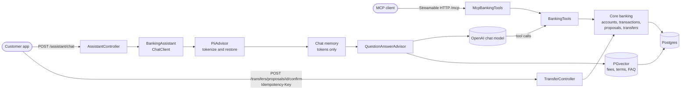

# Banking assistant on Spring AI

[](https://github.com/jaderss/spring-ai/actions/workflows/ci.yml)

A chat assistant for a fictional bank, built on Spring AI 2.0, Spring Boot 4.1 and Java 25. It answers questions about a customer's own accounts through tool calls, explains fees and terms from the bank's documents with citations, proposes transfers that only the customer can confirm, and keeps account numbers and names away from the model.

Everything here is fictional: Acme Bank, its customers Ada Example and Bruno Sample, their accounts and the merchants.

## Architecture



## Run it

```bash
export OPENAI_API_KEY=sk-...
docker compose up
```

That builds the application image and starts it with Postgres and PGvector on `http://localhost:8080`. Flyway creates the schema and loads the fictional customers; the bank documents are embedded on the first start and only re-embedded when they change.

For development, `./mvnw spring-boot:run` starts only Postgres through Spring Boot's Docker Compose support and runs the application from source.

`http/assistant.http` holds the calls below for IntelliJ IDEA or the VS Code REST Client. `X-Customer-Id` stands in for authentication; in production a gateway that has authenticated the customer would set it.

| Endpoint | Does |
|---|---|
| `POST /assistant/chat` | Answers a message; the reply carries the text, the documents retrieved, token usage and pending transfer proposals |
| `GET /transfers/proposals` | Lists the customer's pending proposals |
| `POST /transfers/proposals/{id}/confirm` | Confirms a proposal; requires an `Idempotency-Key` header |
| `GET /accounts/{number}/spending?month=2026-09` | Monthly spending summary |

## Guardrails

- **The customer comes from the request, never from the model.** It reaches the tools through Spring AI's tool context, so no prompt can make a tool act for another customer. Accounts of other customers are reported as not found.
- **The model can only propose a transfer.** `initiateTransfer` records a proposal that expires after ten minutes. Money moves only when the customer confirms it over HTTP with an `Idempotency-Key`; the proposal row is locked during confirmation, replaying the same key returns the original transfer without posting again, and reusing a key for another proposal is rejected with `422`. Transfers lock both accounts in a fixed order, so concurrent transfers cannot overdraw an account.
- **Personal data stays out of the model.** A `PiiAdvisor` replaces account numbers and customer names with per-conversation tokens such as `ACCT_1` and `NAME_1` before chat memory or the model see a message, and restores them in the reply. Tools translate tokens back on input and tokenize their results and error messages, so the model and the stored conversation only ever hold tokens.
- **Tool results are data.** Transaction memos are third-party text. A seeded memo carries a prompt injection that tells the model to move 5000 USD; a test drives a compromised model that obeys it and shows the model received only redacted data, no money moved, and the customer still has to confirm the proposal.
- **The model never does money arithmetic.** The spending summary asks the model only to categorize transactions; the output is validated so every transaction appears exactly once, invalid output is retried with the problem quoted back, and the totals are computed from stored amounts.
- **Policy answers are grounded.** Fees, terms and FAQ answers come from documents retrieved from PGvector, the model cites their labels, and every reply lists the sources that were actually retrieved.

## MCP server

Under the `mcp` profile the same banking tools are exposed through the Spring AI MCP server over Streamable HTTP at `/mcp`, acting for one configured customer (`banking.mcp.customer-id`). The profile has no authentication of its own, so it binds to `127.0.0.1` only. Transfers stay proposals that the customer confirms in the app.

```bash
SPRING_PROFILES_ACTIVE=mcp ./mvnw spring-boot:run
```

Claude Desktop connects through the `mcp-remote` bridge. Add this to `claude_desktop_config.json`:

```json
{
  "mcpServers": {
    "acme-bank": {
      "command": "npx",
      "args": ["mcp-remote", "http://localhost:8080/mcp"]
    }
  }
}
```

## Observability

Every request carries a correlation id from `X-Correlation-Id`, or a generated one. It appears on every log line of the request and as a high-cardinality key on every Micrometer observation, from the chat client call through each model call and tool execution. Replies report the tokens used across all model calls of the request, and the `banking.assistant.tokens` metric records them. `/actuator/health` and `/actuator/metrics` are exposed. Prompt and completion logging stays off, so no customer data reaches the logs through Spring AI.

## Limitations

Conversation state lives in memory: Spring AI's in-memory chat memory and the per-conversation token vault both grow with the number of conversations and are lost on restart. A production deployment would keep chat memory in Postgres with Spring AI's JDBC repository and persist the token mappings alongside it, so that stored tokens can always be restored.

`X-Customer-Id` stands in for authentication. The service must sit behind a gateway that authenticates the customer and sets it.

## Tests and evaluation

`./mvnw verify` needs Docker and no API key. A scripted `ChatModel` plays the model's side of the conversation, including tool calls, so the real Spring AI tool loop, advisors, memory, PGvector retrieval and Postgres run in every test, and a word-hashing embedding model stands in for OpenAI embeddings.

The `eval` suite runs the assistant against the real model and judges it with Spring AI's relevancy and fact-checking evaluators, plus checks that a balance answer carries the tool's figure and that the prompt injection does not become a proposal. It is excluded from the normal build and CI:

```bash
OPENAI_API_KEY=sk-... ./mvnw verify -Peval
```

GitHub Actions runs the build, the tests, the Palantir Java Format check and a gitleaks scan on every push.
